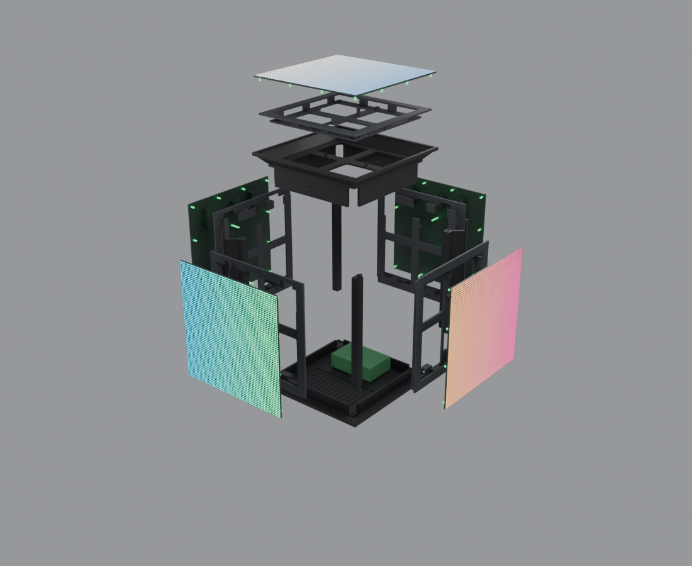

# Cubo LED giratorio

Prototipo de un cubo con 5 matrices LED HUB75 de 64×64 (P3, 192 × 192 mm): 4 caras laterales y 1 superior.
El cubo gira sobre una base con un motor a pasos; dentro va una Raspberry Pi 4.



## Estado

**Versión 1: solo el cubo** (estructura impresa en 3D que sujeta las matrices). La base, el motor, el anillo deslizante
y la electrónica todavía no están diseñados.

- Diseño completo y verificado por ordenador: sin piezas sueltas, sin interferencias entre piezas, los 80 imanes con su pareja
  y el orden de armado comprobado.
- Pendiente: imprimir la plantilla y la probeta de calibración y probarlas con las matrices reales antes de imprimir el resto.

## Cómo está hecho

- **11 piezas impresas** (PETG): placa inferior, 4 columnas de esquina, anillo superior y 5 portamatrices
  (3 laterales variante A, 1 lateral variante B, 1 superior variante B).
- Cada matriz se atornilla a su portamatriz con sus **14 tornillos originales**. Las caras laterales cuelgan de un riel con dos uñas
  y se sujetan con **8 imanes** de 5 × 2 mm y un **tornillo M3 de seguridad**; la cara superior apoya sobre el anillo con 2 pasadores y 8 imanes.
- Cálculos de resistencia de imanes y tornillos en [`calculos_retencion.py`](calculos_retencion.py).

## Imprimir y armar

Los archivos listos para el slicer y la guía paso a paso (ajustes, pausas para meter los imanes, polaridad, orden de impresión
y armado) están en [`imprimir/`](imprimir/INSTRUCCIONES.md).

Además de las piezas impresas hacen falta: 80 imanes de neodimio 5 × 2 mm (N52 recomendado), 12 tornillos M3×8 Allen,
12 insertos térmicos M3 (Ø4.0 × 5.7 mm) y 4 tornillos M2.5×6 autorroscantes para la Raspberry Pi.

## Archivos

| Archivo / carpeta | Qué es |
|---|---|
| `cubo_v1.scad` | Diseño paramétrico en OpenSCAD: **fuente de verdad** de todas las piezas |
| `imprimir/` | STL en orientación de impresión + `INSTRUCCIONES.md` |
| `blender/cubo_v1.blend` | Escena de Blender del cubo (montado, explotado con la propiedad `Explosion`, animación de giro) |
| `blender/*.py` | Exportación a STL, construcción de la escena, renders y verificaciones automáticas |
| `calculos_retencion.py` | Resistencia de imanes, tornillos y uniones |
| `calculos_preliminares.py` | Órdenes de magnitud del rotor, motor, base y alimentación |
| `cubo_led.scad` | Modelo anterior (v0.2), solo de referencia |

## Regenerar después de cambiar el diseño

Requiere OpenSCAD 2021.01 y Blender 5.x.

```
python blender/exportar_stl.py                        # piezas en posición de montaje -> blender/stl/
blender -b --python blender/construir_blend.py        # escena cubo_v1.blend
blender -b --python blender/interferencias_blender.py # verificaciones (hay más en blender/verificar_*.py y montaje_*.py)
python exportar_impresion.py                          # archivos de impresión -> imprimir/
```
